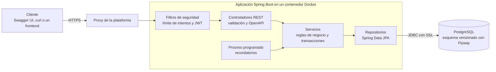
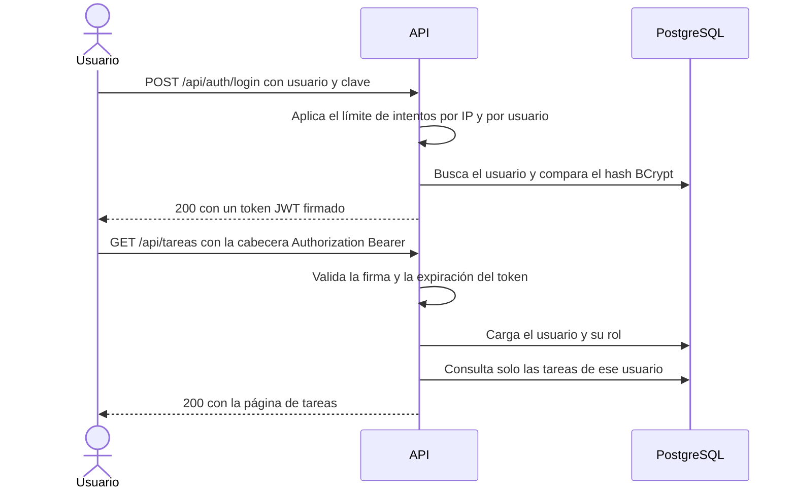
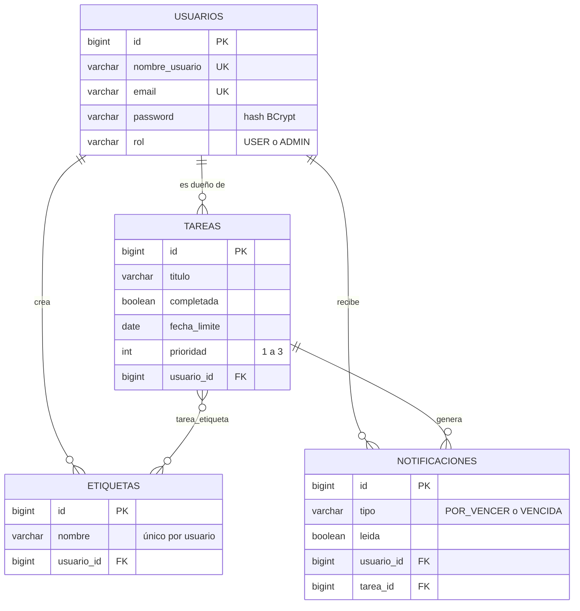

# Gestor de Tareas — API REST con Spring Boot

[](https://github.com/yarlinson/gestor-tareas-java/actions/workflows/ci.yml)

API REST para gestionar tareas personales. Cada usuario se registra, inicia sesión y administra **únicamente sus propias tareas**, con prioridades, etiquetas, avisos de vencimiento y un panel de administración. Es la versión en Java del "Sistema de Gestión de Tareas" que antes hice con Django REST Framework.

## Demo en vivo

**<https://gestor-tareas-yv7x.onrender.com>** abre la documentación interactiva (Swagger UI): regístrate con `POST /api/auth/registro`, pulsa **Authorize** con el token recibido y prueba los endpoints.

> Está desplegada en el plan gratuito de Render, que apaga el servicio tras 15 minutos sin tráfico. **La primera visita después de un rato puede tardar de uno a tres minutos** en responder mientras la aplicación vuelve a arrancar. Es una demo pública: no guardes datos reales.

## Qué incluye

- **Autenticación con JWT** y contraseñas con BCrypt; límite de intentos por IP y por nombre de usuario.
- **Tareas** con prioridad (baja, media, alta), fecha límite, estado y **etiquetas** (relación muchos a muchos, propias de cada usuario).
- **Búsqueda y filtros** por estado, texto, prioridad, etiqueta y vencidas, con paginación y orden.
- **Avisos de vencimiento:** un proceso programado crea notificaciones de tareas por vencer y vencidas.
- **Roles:** los usuarios con rol `ADMIN` acceden a estadísticas y al listado de usuarios.
- **Documentación OpenAPI**, migraciones versionadas con Flyway, pruebas contra PostgreSQL real, CI y despliegue con Docker.

## Tecnologías

| Área | Tecnología |
|---|---|
| Lenguaje | Java 21 |
| Framework | Spring Boot 3.5 (Web, Validation, Actuator, tareas programadas) |
| Persistencia | Spring Data JPA / Hibernate, PostgreSQL 16 |
| Migraciones | Flyway |
| Seguridad | Spring Security 6, JWT (jjwt), BCrypt, roles con `@PreAuthorize`, límite de intentos (Bucket4j) |
| Documentación | OpenAPI / Swagger UI (springdoc) |
| Pruebas | JUnit 5, MockMvc, AssertJ, Testcontainers (PostgreSQL real), JaCoCo |
| Contenedores | Docker, Docker Compose |
| CI/CD | GitHub Actions, Dependabot |
| Despliegue | Render (Docker) + Neon (PostgreSQL), plan gratuito |

## Arquitectura



### Flujo de autenticación



### Modelo de datos



## Endpoints

| Método | Ruta | Descripción | Acceso |
|---|---|---|---|
| POST | `/api/auth/registro` | Crea un usuario y devuelve su token | Público |
| POST | `/api/auth/login` | Inicia sesión y devuelve un token | Público |
| GET | `/api/tareas` | Lista tareas propias (filtros, orden y paginación) | Usuario |
| GET | `/api/tareas/{id}` | Obtiene una tarea | Usuario |
| POST | `/api/tareas` | Crea una tarea | Usuario |
| PUT | `/api/tareas/{id}` | Reemplaza título, descripción, fecha límite, prioridad y etiquetas | Usuario |
| PATCH | `/api/tareas/{id}/estado` | Marca como completada o pendiente | Usuario |
| DELETE | `/api/tareas/{id}` | Elimina una tarea | Usuario |
| GET | `/api/etiquetas` | Lista las etiquetas propias con el número de tareas que las usan | Usuario |
| DELETE | `/api/etiquetas/{id}` | Elimina una etiqueta y la quita de las tareas | Usuario |
| GET | `/api/notificaciones` | Lista los avisos propios (`leida=false` solo los pendientes) | Usuario |
| PATCH | `/api/notificaciones/{id}/leida` | Marca un aviso como leído | Usuario |
| GET | `/api/admin/usuarios` | Lista los usuarios con rol y número de tareas | Admin |
| GET | `/api/admin/estadisticas` | Totales de usuarios y tareas | Admin |
| POST | `/api/admin/recordatorios/generar` | Ejecuta ahora el proceso de avisos | Admin |

Parámetros de `GET /api/tareas`: `completada=true|false`, `q=texto` (título y descripción, sin distinguir mayúsculas), `prioridad=BAJA|MEDIA|ALTA`, `etiqueta=nombre`, `vencidas=true|false`, `page`, `size` (máx. 100) y `sort` (por ejemplo `sort=prioridad,desc`, que ordena por importancia y no alfabéticamente).

Documentación interactiva: <http://localhost:8080/swagger-ui.html> en local, o la URL de la demo (el botón **Authorize** acepta el token de `/api/auth/login`).
Estado del servicio: `/actuator/health`.

## Cómo ejecutarlo

### Opción 1: Docker Compose (API + base de datos)

```powershell
Copy-Item .env.example .env      # luego edite .env con sus propios valores
docker compose up --build
```

La API queda en `http://localhost:8080` (si ese puerto está ocupado, defina `API_PORT` en `.env`). PostgreSQL se publica en el puerto `5433` del equipo.

### Opción 2: Maven con un PostgreSQL propio

Cree una base de datos `gestor_tareas` y un usuario `gestor`, y defina las variables de entorno:

```powershell
$env:DB_PASSWORD = "su_clave"
$env:JWT_SECRET  = "un-secreto-aleatorio-de-al-menos-32-caracteres"
# Opcionales: DB_URL (por defecto jdbc:postgresql://localhost:5432/gestor_tareas), DB_USER (por defecto gestor)
mvn spring-boot:run
```

Para tener un administrador, defina también `ADMIN_USERNAME` y `ADMIN_PASSWORD` antes del primer arranque (ver [docs/DESPLIEGUE.md](docs/DESPLIEGUE.md)).

### Ejemplo de uso

```bash
# Registro (devuelve un token)
curl -X POST http://localhost:8080/api/auth/registro \
  -H "Content-Type: application/json" \
  -d '{"nombreUsuario":"ana","email":"ana@correo.com","password":"ClaveSegura123"}'

# Crear una tarea con prioridad, fecha límite y etiquetas
curl -X POST http://localhost:8080/api/tareas \
  -H "Authorization: Bearer <TOKEN>" -H "Content-Type: application/json" \
  -d '{"titulo":"Estudiar Spring Security","prioridad":"ALTA","fechaLimite":"2030-01-31","etiquetas":["estudio","java"]}'

# Pendientes de prioridad alta con la etiqueta "java", las más importantes primero
curl "http://localhost:8080/api/tareas?completada=false&prioridad=ALTA&etiqueta=java&sort=prioridad,desc" \
  -H "Authorization: Bearer <TOKEN>"

# Avisos sin leer
curl "http://localhost:8080/api/notificaciones?leida=false" -H "Authorization: Bearer <TOKEN>"
```

## Despliegue

La aplicación está preparada para publicarse en [Render](https://render.com) (contenedor Docker) con PostgreSQL en [Neon](https://neon.com), ambos con plan gratuito. La guía paso a paso está en [docs/DESPLIEGUE.md](docs/DESPLIEGUE.md) y el servicio se describe en [`render.yaml`](render.yaml).

- Toda la configuración llega por variables de entorno (`DB_URL`, `DB_USER`, `DB_PASSWORD`, `JWT_SECRET`); el puerto lo toma de `PORT`, que define la plataforma.
- La URL raíz redirige a Swagger UI, así que el enlace público abre directamente la documentación interactiva.
- Con el plan gratuito el servicio se duerme tras un rato sin tráfico: la primera petición posterior puede tardar de uno a tres minutos mientras la aplicación vuelve a arrancar.

## Pruebas

```powershell
mvn test      # ejecuta las pruebas
mvn verify    # además genera el informe de cobertura en target/site/jacoco/index.html
```

**Requieren Docker en ejecución.** Las pruebas de integración usan [Testcontainers](https://testcontainers.com/): levantan un PostgreSQL 16 real (la misma imagen que `docker-compose.yml`), arrancan la aplicación completa contra él y lo eliminan al terminar. Un único contenedor se comparte entre todas las clases de prueba para no pagar el arranque varias veces.

Como Flyway y la validación del esquema de Hibernate siguen activos, las pruebas también comprueban que las migraciones coinciden con las entidades sobre la misma base de datos que se usa en producción, sin diferencias de dialecto como las que habría con una base en memoria.

Cubren registro y login, validaciones, aislamiento entre usuarios, filtros, búsqueda, paginación y ordenamiento, prioridades y etiquetas, roles y permisos del panel de administración, límites de intentos (por IP, por cabecera y por usuario) y rechazo de tokens manipulados. Los recordatorios se prueban con una fecha fija para no depender del día en que se ejecuten, y una prueba arranca el proceso programado con su configuración real. Además hay pruebas unitarias del servicio JWT.

## Integración continua

El flujo de [`.github/workflows/ci.yml`](.github/workflows/ci.yml) se ejecuta en cada push a `main` y en cada pull request:

1. **Compilar y probar:** `mvn verify` con Java 21. Testcontainers usa el Docker que ya trae el runner de GitHub.
2. **Cobertura:** el resumen de la ejecución muestra el porcentaje de líneas cubiertas y el informe HTML de JaCoCo queda como artefacto descargable.
3. **Imagen Docker:** comprueba que el `Dockerfile` sigue construyendo (no se publica la imagen).

[Dependabot](.github/dependabot.yml) abre pull requests semanales para actualizar dependencias de Maven, acciones de GitHub e imágenes base de Docker.

## Decisiones de diseño

- **JWT sin estado y sin CSRF.** El token viaja en el encabezado `Authorization`, no en cookies, por eso la protección CSRF no aplica y se desactiva de forma explícita.
- **Aislamiento por usuario.** Todas las consultas filtran por el propietario. Una tarea, etiqueta o aviso ajeno responde `404` igual que uno inexistente, para no revelar qué identificadores existen.
- **Roles leídos en cada petición.** El rol se carga de la base de datos con el usuario, así que quitar un rol surte efecto de inmediato aunque el token siga vigente. Los endpoints de `/api/admin` usan `@PreAuthorize`.
- **El administrador no sale del registro público.** Se crea al arrancar desde `ADMIN_USERNAME` y `ADMIN_PASSWORD`, y una cuenta que ya existe nunca se promueve ni se modifica: registrarse antes con ese nombre no sirve para quedarse con el rol.
- **Esquema versionado.** Flyway crea y evoluciona las tablas (`db/migration`, versiones V1 a V4) e Hibernate solo valida (`ddl-auto: validate`).
- **Pruebas contra la base real.** Testcontainers en lugar de H2, para detectar diferencias de SQL y de migraciones antes de llegar a producción.
- **Filtros dinámicos con `Specification`.** Estado, texto, prioridad, etiqueta y vencidas son opcionales y se combinan sin escribir una consulta por cada variante; los comodines `%` y `_` de la búsqueda se escapan.
- **Prioridad numérica.** Se guarda como número (1 a 3) y se convierte al enumerado, para que ordenar siga la importancia en vez del orden alfabético.
- **Etiquetas por usuario.** Los nombres se normalizan y se reutilizan; se crean al asignarlas a una tarea. Se cargan por lotes para no hacer una consulta por tarea en los listados.
- **Recordatorios idempotentes.** Una restricción única (tarea y tipo) impide avisos duplicados, así que el proceso se puede repetir sin riesgo. Se ejecuta cada hora, al arrancar y a demanda, porque un servicio que duerme no cumple un horario fijo. Si cambia la fecha límite de una tarea, sus avisos se borran mediante un evento de dominio, para que el módulo de tareas no dependa del de notificaciones.
- **Zona horaria configurable.** "Hoy" (tareas vencidas y avisos) se calcula en `APP_TIMEZONE` y no en la del servidor, que suele ser UTC.
- **Errores estándar (RFC 7807).** Las respuestas de error usan `application/problem+json`; las validaciones incluyen el detalle por campo.
- **Secretos por variables de entorno.** La aplicación no arranca si falta `JWT_SECRET` o si tiene menos de 32 caracteres.
- **Límite de intentos.** `/api/auth/**` admite 10 intentos por minuto y por cliente y, además, el login admite 5 por minuto para cada nombre de usuario sin importar la IP, lo que protege las cuentas de la fuerza bruta (token bucket con Bucket4j); el exceso recibe `429` con `Retry-After`. Se configura con `RATE_LIMIT_*` y está pensado para una sola instancia: con varias habría que compartir el estado, por ejemplo en Redis. Detrás de un proxy la IP de la conexión no es la del visitante, así que hay que indicar la cabecera con la IP real (`RATE_LIMIT_CLIENT_IP_HEADER`); los detalles y la comprobación en [docs/DESPLIEGUE.md](docs/DESPLIEGUE.md).

## Estructura

```
src/main/java/com/yarlinson/gestortareas/
├── auth/          Registro e inicio de sesión
├── tarea/         Tareas y etiquetas: entidades, filtros, servicios y controladores
├── notificacion/  Avisos de vencimiento y proceso de recordatorios
├── usuario/       Usuario y rol
├── admin/         Panel de administración y creación del administrador inicial
├── security/      JWT, filtro de autenticación y usuario autenticado
├── ratelimit/     Límites de intentos por IP y por usuario
├── config/        Configuración de seguridad, reloj y OpenAPI
└── common/        Manejo global de errores y respuesta paginada
src/main/resources/db/migration/   Migraciones de Flyway
src/test/java/                     Pruebas de integración (Testcontainers) y unitarias
docs/                              Guía de despliegue
.github/                           Workflow de CI y configuración de Dependabot
```
